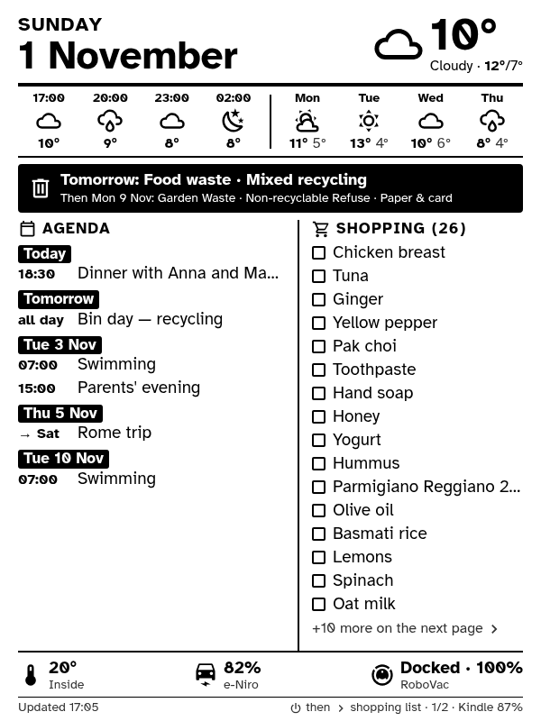
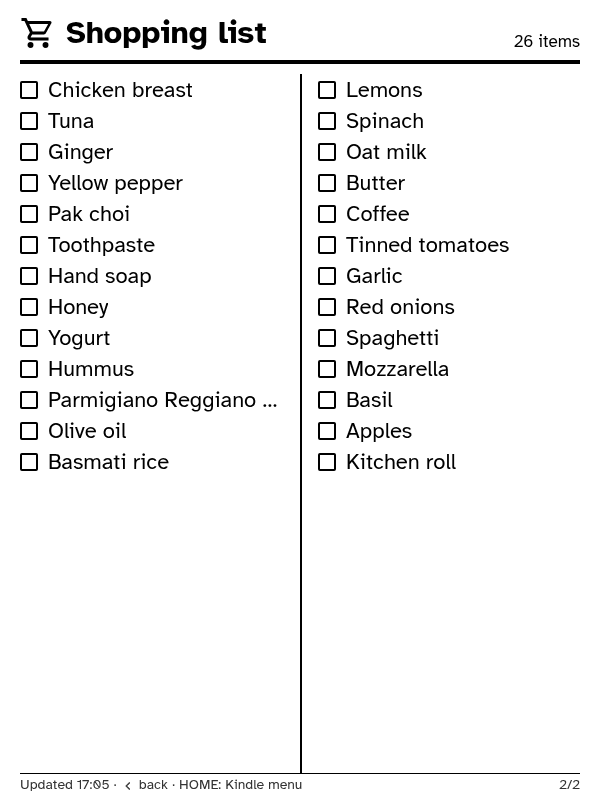

# kindle-fridge-dashboard

A jailbroken Kindle 4 on the fridge shows a household dashboard and refreshes it once an
hour. Between refreshes it is suspended to RAM, and the e-ink panel keeps the picture
without power.

<p align="center">
  
  &nbsp;
  
</p>

<sub>Rendered from the test fixtures with `scripts/preview.py`. These are the exact
600×800, 16-gray PNGs the Kindle displays.</sub>

## Features

- **Page 1:**
  - the date and current weather, with four 3-hourly forecast slots and the next 4
    days;
  - the next two bin collections, inverted when one is today or tomorrow;
  - a two-week agenda from Google Calendar or any other iCal feed;
  - the Home Assistant shopping list;
  - a sensor strip: room temperature, car battery and range, robot vacuum.
- **Pages 2+:** the full shopping list.
- **Power button:** refreshes the dashboard on demand, then the page keys flip through
  the pages.
- **Battery:** each hourly wake takes about 15 s, and there are no wakes overnight
  (quiet hours are configurable).
- **Monitoring:** Home Assistant can track the Kindle's battery, whether it is keeping
  to its schedule, and the current dashboard image.

## How it works

```
Docker host (server/)                                   Kindle 4 (kindle/)
 every 10 min, and 20 s before the Kindle's wake:        RTC alarm, on the hour
   Home Assistant REST ─┐                                  → WiFi on
   iCal feeds ──────────┼─→ Jinja2 HTML                    → GET /dash.png?batt=..&next=..
                        └─→ headless Chromium   ◄────────  → eips (full refresh)
                            → 600×800, 16 grays            → WiFi off
                            → page1.png … pageN.png        → RTC alarm → suspend to RAM
        │
        └─ GET /status, /dash.png ──→ Home Assistant: online, battery, charging, image
```

The Kindle does no rendering. Its 2011 browser and TLS stack can't handle a modern page,
so the server sends finished grayscale PNGs over plain HTTP on the LAN. The device side
is a few hundred lines of BusyBox shell that need nothing beyond the stock firmware.

## Requirements

- **Kindle 4 Non-Touch**, jailbroken, with KUAL and USBNetwork installed (see
  [docs/kindle.md](docs/kindle.md#prerequisites)).
- **A Docker host** on the same network.
- **Home Assistant** with a long-lived access token. The dashboard uses a weather
  entity, a to-do list and a few sensors. A missing one shows as "—" or "unavailable"
  rather than breaking the page.
- **Optionally, calendar feeds:** Google Calendar's secret iCal address, or any other
  iCal URL.

## Quick start

1. **Server.** On the Docker host:

   ```bash
   cd server
   cp .env.example .env        # set HA_URL, HA_TOKEN, ICAL_URLS and your entity ids
   docker compose up -d --build
   ```

   Open `http://<host>:8090/` to check the preview. See
   [docs/server.md](docs/server.md).
2. **Kindle.**
   - Copy `kindle/fridgedash/` to `fridgedash/` and `kindle/extensions/fridgedash/`
     to `extensions/fridgedash/` on the Kindle's USB drive.
   - Set `SERVER` in `fridgedash/config.sh`.
   - Run KUAL → **Fridge dashboard** → **Start dashboard (hourly, low power)**.

   See [docs/kindle.md](docs/kindle.md).
3. **Home Assistant monitoring (optional).** Install `ha/fridge_kindle.yaml` as a
   package. See [docs/home-assistant.md](docs/home-assistant.md).

## Repository layout

```
server/                 FastAPI app, Dockerfile, docker-compose.yml, tests
  fridgedash/           config, data sources, rendering, HTTP endpoints, template
kindle/
  fridgedash/           dash.sh (the loop), start/stop, autostart + boot hook, config.sh
  extensions/fridgedash KUAL menu
  tests/                shell unit tests (run on the host or the Kindle)
ha/                     Home Assistant package for monitoring
scripts/                preview.py (render sample pages), deploy-server.sh
docs/                   server, Kindle and Home Assistant guides; Kindle 4 device notes
```

## Documentation

- [docs/server.md](docs/server.md): configuration, endpoints, layout changes and tests.
- [docs/kindle.md](docs/kindle.md): installation, configuration, use, logs and recovery.
- [docs/home-assistant.md](docs/home-assistant.md): the monitoring package, a
  dashboard card and an example automation.
- [docs/kindle4-notes.md](docs/kindle4-notes.md): what was learned about the Kindle 4's
  BusyBox, power management, e-ink and input, for anyone scripting this device.

## Development

```bash
python -m venv .venv && source .venv/bin/activate
pip install -r server/requirements-dev.txt
(cd server && python -m pytest)                          # server tests
sh kindle/tests/test_dash.sh kindle/fridgedash/dash.sh   # Kindle tests
shellcheck -s sh -x kindle/fridgedash/*.sh scripts/*.sh
python scripts/preview.py /tmp/preview                   # render sample pages
```

Python is formatted with `black`.

## Credits and license

The code is released under the [MIT license](LICENSE). Vendored assets keep their own
licenses:

- [Atkinson Hyperlegible](https://www.brailleinstitute.org/freefont/) font: SIL Open
  Font License (`server/fridgedash/static/fonts/OFL.txt`).
- [Material Design Icons](https://pictogrammers.com/library/mdi/), the icon set Home
  Assistant uses: Apache License 2.0 (`server/fridgedash/static/icons/LICENSE`).

The Kindle work builds on the MobileRead community's jailbreak, KUAL and USBNetwork,
and on the device knowledge collected in [KOReader](https://github.com/koreader/koreader).
